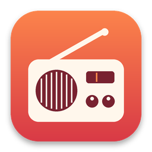

# RadioTray per Mac

Lettore di radio via Internet nella barra dei menu di macOS, ispirato a
[Radiotray-NG](https://github.com/ebruck/radiotray-ng) per Linux, pensato per un iMac 27" Late 2009
con **macOS High Sierra 10.13** (funziona anche sulle versioni successive).



- [Analisi di Radiotray-NG](docs/ANALISI.md)
- [Piano di sviluppo](docs/PIANO.md)

## Stato

| Fase | Contenuto | Stato |
|---|---|---|
| 1 | icona e menu, stazioni a gruppi (stesso `bookmarks.json` di Radiotray-NG), playlist PLS/M3U/ASX/XSPF, AVPlayer, titolo e artista, volume, ultima stazione, notifiche, `.dmg` dalla CI | fatta (provata sull'iMac) |
| 2 | titolo letto dallo stream (ICY), timer di spegnimento, stazione successiva/precedente, tasti multimediali, Apri URL…, ricarica automatica, riconnessione | fatta (provata sull'iMac) |
| 2.5 | nome vero della stazione, Aggiungi alle stazioni…, Cerca stazioni (Radio Browser), radio italiane consigliate | da provare sull'iMac |
| 3 | editor delle stazioni, importazione, avvio al login | — |

## Scaricare

Ogni push compila l'app su GitHub Actions. Il `.dmg` si trova nella release
[**anteprima**](../../releases/tag/anteprima). Le istruzioni sono nel file `LEGGIMI.txt` dentro il `.dmg`. Al primo avvio:
clic destro sull'app → Apri.

## Compilare su un Mac

Servono gli strumenti a riga di comando di Xcode (`xcode-select --install`). Non servono altre dipendenze.

```sh
make test               # test della logica
make app                # build/RadioTray.app (x86_64, macOS 10.13)
make check-mac          # verifica architettura, versione minima, firma
make dmg                # build/RadioTray.dmg
make stations           # controlla che le stazioni predefinite rispondano
```

## Struttura

- `src/` Objective-C + Cocoa, nessuna libreria esterna:
  - `RTBookmarks`, `RTPlaylistParser`, `RTTrackInfo`: logica, solo Foundation (testata in `tests/`)
  - `RTStreamResolver`: scarica i primi 4 KB dell'URL e decide se è una playlist o uno stream
  - `RTPlayer`: AVPlayer, stato, titolo ICY, prova degli URL alternativi
  - `RTAppDelegate`: icona nella barra dei menu, menu, azioni, notifiche
- `resources/` Info.plist, icona, stazioni predefinite
- `mac/` script per bundle, verifica e `.dmg`
- `tools/make_icon.py` rigenera l'icona (Pillow)
